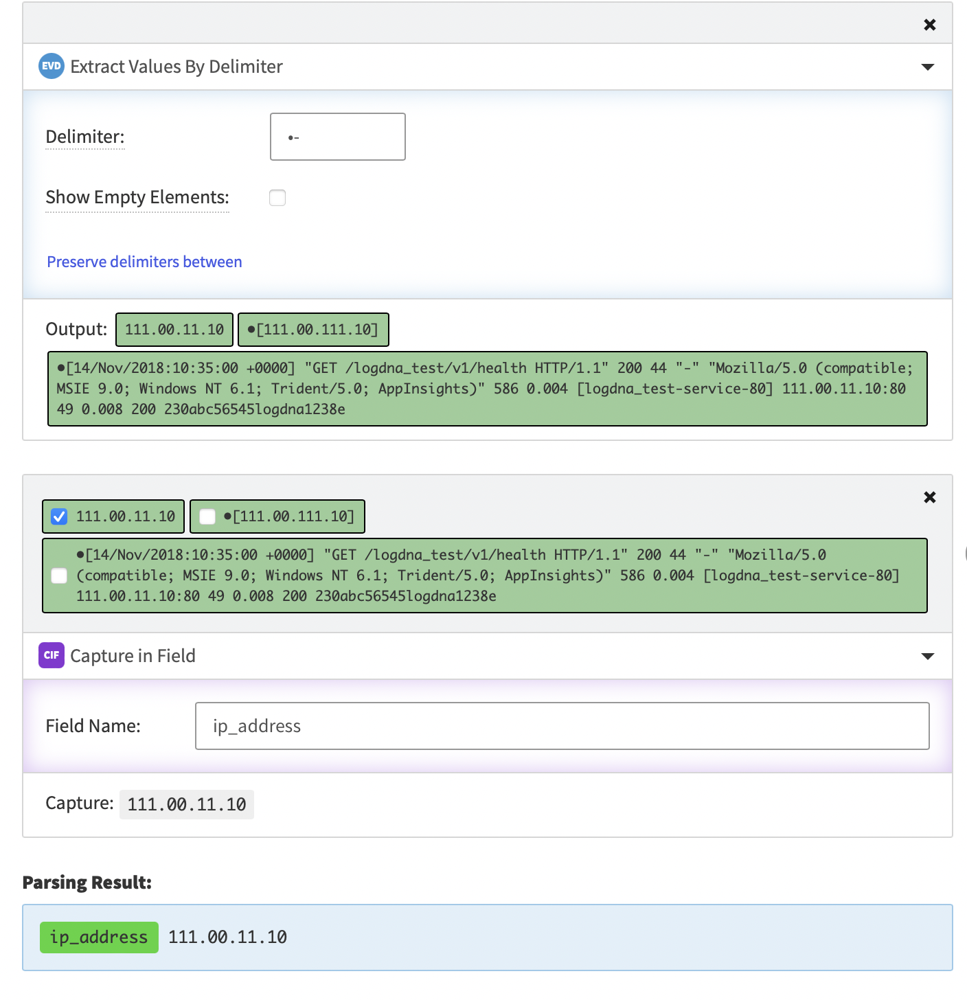
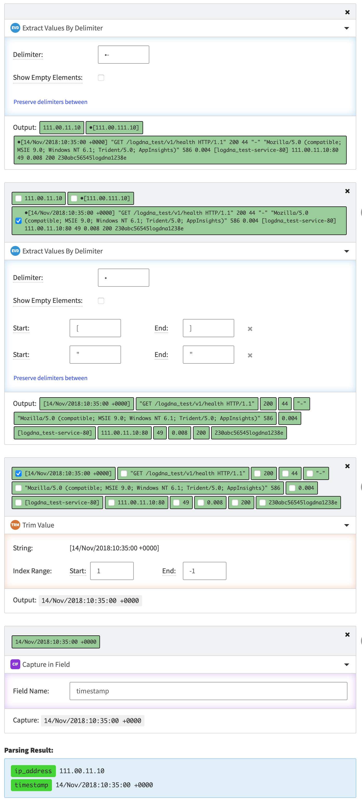
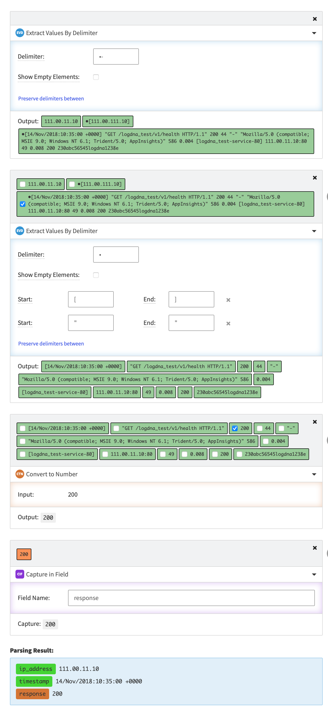
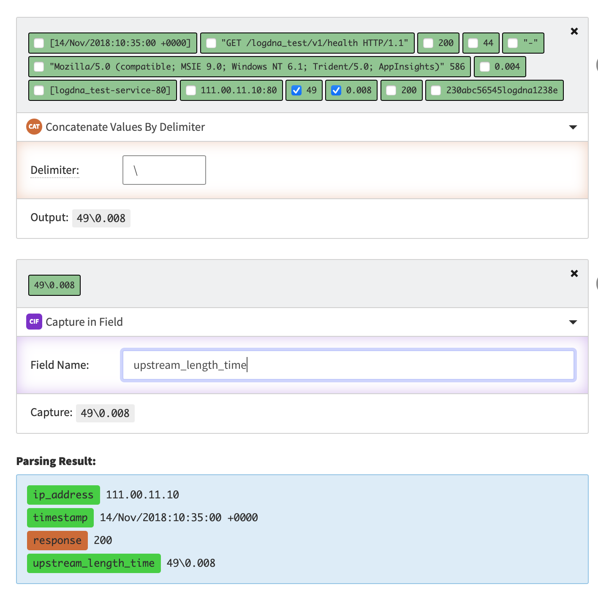
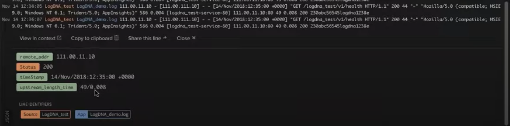

<Note>
Must be an [admin or owner](/docs/rbac) to use this feature.
</Note>

You'll learn how to parse ingested log lines. This will cover the parsing screen, the parsing mini map, and using some of the parsing functions available. You can parse all four values or parse one and move onto Validate Templates.

You'll use the following log lines throughout and you'll parse:

- `ip_address: 111.00.11.10`
- `timestamp: 14/Nov/2018:10:35:00 +0000`
- `response: 200`
- `upstream_length_time: 49/0.008`

```bash
111.00.11.10 - [111.00.111.10] - - [14/Nov/2018:10:35:00 +0000] "GET /logdna_test/v1/health
HTTP/1.1" 200 44 "-" "Mozilla/5.0 (compatible; MSIE 9.0; Windows NT 6.1; Trident/5.0; AppInsights)"
586 0.004 [logdna_test-service-80] 111.00.11.10:80 49 0.008 200 230abc56545logdna1238e

```

## Parse a String

You are going to parse `111.00.11.10` from the log line.

1. Go to [Parsing Templates](https://app.mezmo.com/manage/custom-parsing/templates) and click **Create a Template**.
2. In Choose a Log Line, select **Add my own log line**. You'll be using the log line from the introduction.
3. Click **Build a Parsing Template**. You will see the line you entered as a Reference Line.
4. First, you are going to break the text down into smaller parts to so you can use the part you want. In Choose an Extractor, select **Extract Value By Delimiter**. 
5. Enter a space and then a dash.
6. Now you should see `111.00.11.10` and `*[111.00.111.10]` as part of the lines parsed.
7. Select `111.00.11.10` and choose the operator,**Capture in Field.** Give a label `ip_address`.
8. The result is shown at the bottom of the parsing page.

<Frame caption="Results of parsing the string 111.00.11.10 as the IP Address">
  
</Frame>

## Parse a Timestamp

You'll parse `14/Nov/2018:10:35:00 +0000` from the log line.

1. Select the circle with the plus sign to create a **Sibling Operator.** When you create a sibling operator, the mini map updates to show the relationship between operators and the template screen updates to have a new Choose an Operator. Learn more in [Edit Parsing Operations with the Mini-Map](/docs/edit-parsing-operations-with-the-mini-map).
2. Check the longer output that includes the timestamp.
3. Choose an operator &gt; **Extract by Delimiter.**
4. Enter a space into the delimiter. 
5. Notice the output has split everything by space, including part of timestamp. To fix the timestamp, you need to preserve some of the spaces.
6. Click **Preserve delimiters between.** 
7. Start use a left square bracket `[` and end use a right square bracket, `]` .
8. Click **Preserve delimiters between** again**.** Use double quotes `"` for both start and end. You'll notice that the timestamp is now cleaned up, along with some of other output.
9. Now we need to remove the brackets from the timestamp, so it's easier to run diagnosis against. Select the timestamp. `[14/Nov/2018:10:35:00 +0000]` , choose operator, T**rim Value**. 
10. Trim Value is 0 based counting. Start, enter `1` , for end enter  `-1`.
11. Your output should be the timestamp. 
12. Choose operator &gt; **Capture in Field** and label it `timestamp` .
13. So far, you've captured two fields from the log line.

<Frame caption="Results of parsing the timestamp">
  
</Frame>

## Parse a Number

You are going to parse `200` from the log line.

1. Using the mini map, select Trim Value. Trim Value is orange, you can also hover over the icons in the mini map. Using the mini map lets you jump between parsed areas. By starting from Trim Value, you can start from a place where the 200 is already separated from the other values, making it easier to use.
2. Click **Add a Sibling Operator**.
3. Select 200.
4. Choose an operator &gt; **Convert to Number.**
5. Choose an operator &gt; **Capture in Field**. Field name is `response.` 

<Frame caption="Results of parsing the 200 response">
  
</Frame>

## Concatenate Log Lines

You are going to parse `49` and `0.008` from the log line.

1. Create a sibling operator to either Trim Value or Convert to Number in the mini map. 
2. Select `49` and `0.08` from the output.
3. Choose an operator &gt; **Concatenate Values by Delimiter**.
4. Enter a forward slash `\` as the value.
5. Choose an operator &gt; **Capture in Field**.
6. The field name is `upstream_length_time.`

<Frame caption="Results of concatenating 49 and 0.008">
  
</Frame>

## Validate Template

Before you can make a template active, you must check that the log lines you want are working. 

1. Add a log line to test against in **Add a Line**. You can use the example line. When testing you want to be sure to test multiple lines by adding lines. 
2. You can also test by adding a query to `Apply this parsing template to sample lines matching this query:`. This step is required and is the scope of the parsing template.
3. Mark the log lines as valid or invalid. 
    1. If a line is marked as invalid you'll be taken back to the Parsing Template step.

4. Activate changes to apply your changes.

<Warning>
Active parsing templates are only applied to the lines that come in after the template has been enabled. All log lines that were ingested prior to the template becoming active are not parsed by the parsing template.
</Warning>

## Results

The log lines the template applies to will show in the Log Viewer.



## Create a Template with the New Editor

The sections above use the classic editor. In the new editor, you build each field by highlighting a value in a real log line, and you see the result on every test line before you publish.

1. Go to [Parsing Templates](https://app.mezmo.com/manage/custom-parsing/templates) and select **Try the new editor**.
2. Select **New template**.
3. In the name box at the top of the page, enter a name for the template.
4. Under **Test lines**, enter a search query for the log lines this template parses, such as `app:checkout-api`, and select **Pull samples**. The test lines are the most recent matching lines from the last 3 days. To use your own line instead, select **+ Paste a line**.
5. In a test line, highlight the value you want to capture. The **Capture as a field** dialog opens.
6. Enter a field name. Field names can't start with an underscore or contain spaces.
7. Optional. To store the value as a number, under **Store as**, select **Number**.
8. Under **Find it by**, select one of the suggested ways to find the value. To chain steps such as split, text between, JSON, CSV, join, and trim yourself, select **Build the steps myself**. The dialog shows the value found on each test line.
9. Select **Add field**. Mezmo saves the template as a draft, and the **Found in** column shows how many test lines contain the field. To add more fields, repeat steps 5 through 9.
10. Select **Publish**. You need a query and at least one field to publish.

Changes to live templates can take up to 15 minutes to take effect.

### Edit a Live Template in the New Editor

The new editor doesn't change a live template in place. Instead, it creates a draft, and the live template keeps running until you publish the draft.

1. On the Manage Parsing page, select the template.
2. Select **Edit**. If the template already has a draft, select **Open draft** instead.
3. Change the fields or query.
4. Select **Publish changes**. To delete the draft and keep the live template as it is, select **Discard changes** instead.

<Warning>
If you edit a template from the classic editor that has branches that don't capture a field, the new editor removes those branches the next time you change a field.
</Warning>
