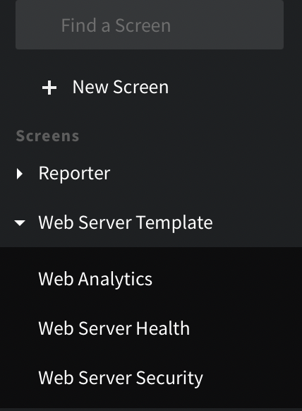

You can organize Boards, Views, and Screens by Categories. There are two ways to create Categories. 

- When you create the Board, Screen, or View and give it a name and category.
- By going to the Categories screen and adding a new Category.

<Frame caption="The Category is Web Server Template and it contains Web Analytics, Web Server Health, and Web Server Security.">
  
</Frame>

## Manage Categories

Manage all of your categories under **Settings** &gt; **Categories**. The page lists one type of item at a time, with the category each item belongs to.

- To change the type of item, select **Views**, **Boards**, or **Screens** from the item type list. If your organization uses federated search, you can also select **Federated views**.
- To narrow the list, select a category or **Uncategorized** from the category filter, or enter part of an item's name in the search box.

### Create, Rename, or Delete a Category

Each item type has its own categories. Views and federated views share the same set of categories.

On the **Categories** page, select **Manage &lt;type&gt; categories**, for example **Manage view categories**. A panel lists the categories for that item type and how many items each one contains. In the panel:

- To create a category, enter a name in the **New category name** field and select **Add**.
- To rename a category, select **Rename** next to it, enter the new name, and select **Save**.
- To delete a category, select **Delete** next to it, then select **Delete category** to confirm. Mezmo keeps the items and removes them from the category.

### Assign Items to a Category

- To move one item, select a category from the item's list in the **Category** column. Select **Uncategorized** to remove the item from its category.
- To move several items, select the checkbox next to each item, then select a category from the **Move to** list.

To put items into a category that doesn't exist yet, select **+ New category…** from either list. Then enter a name in the panel and select **Add**. Mezmo creates the category and moves the items into it.

When you choose a category, the item moves into that category and leaves any other category it belonged to.

## Permissions

The Categories permission has three cumulative levels (Manage includes Write; Write includes Read).

- **Read**: view the Categories page and browse categories and their contents; no changes possible.
- **Write**: everything Read allows, plus create a category, rename a category, and add or remove Views, Boards, and Screens to and from a category.
- **Manage**: everything Write allows, plus delete a category.

Assign these levels to roles at Settings &gt; Organization &gt; Roles. See [Role-Based Access Control](/docs/rbac).

## Feature Notes

- An item that belongs to more than one category shows the number of categories in the **Category** column. Hover over it to see the category names.
- Deleting a Category, does not delete the View, Board, or Screen.
